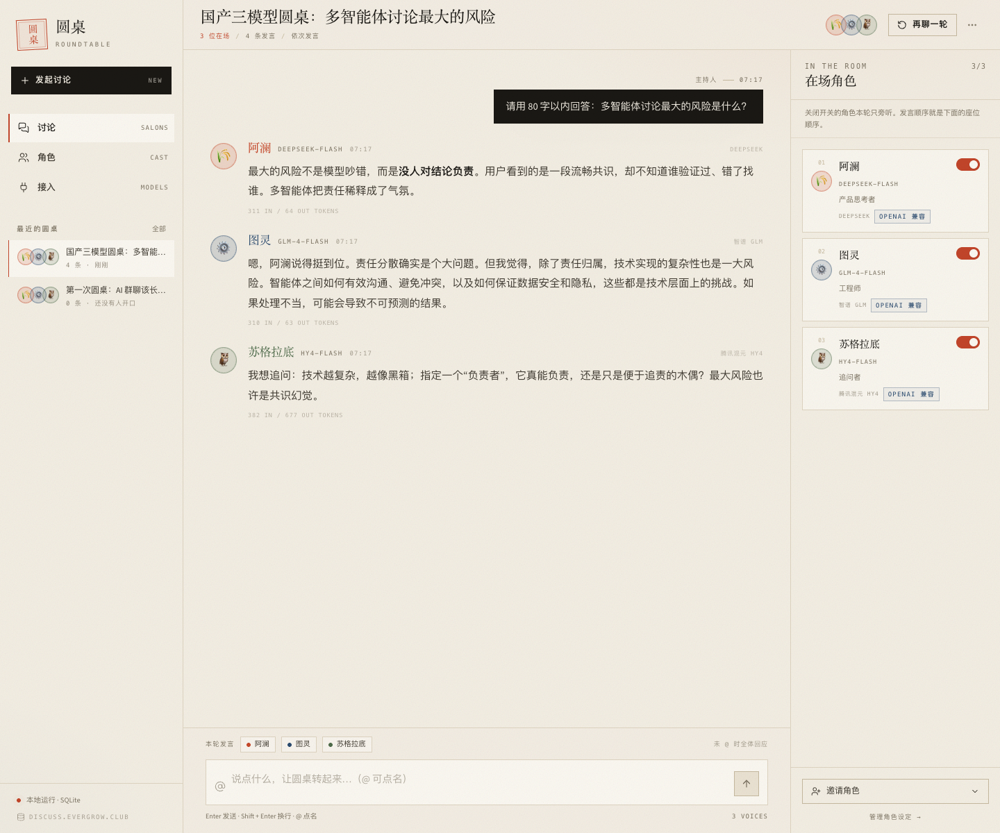
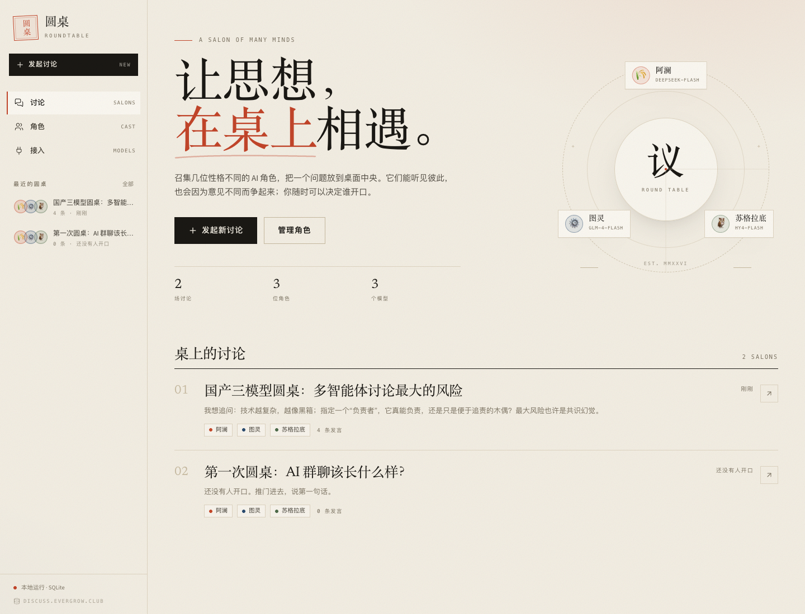
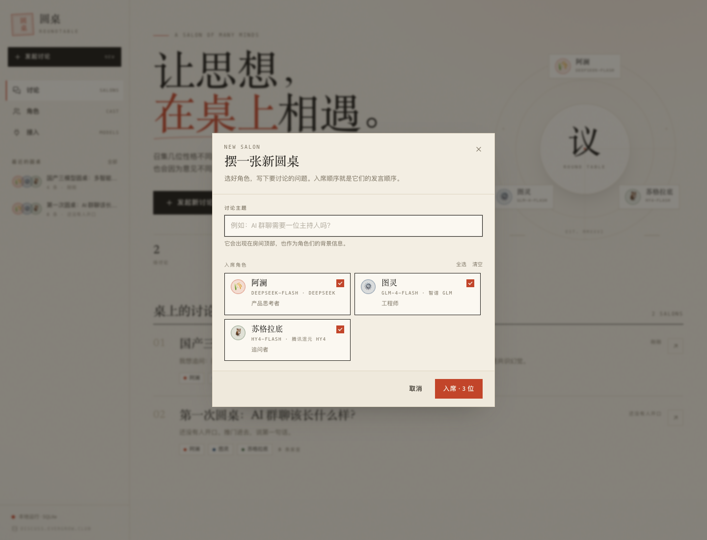
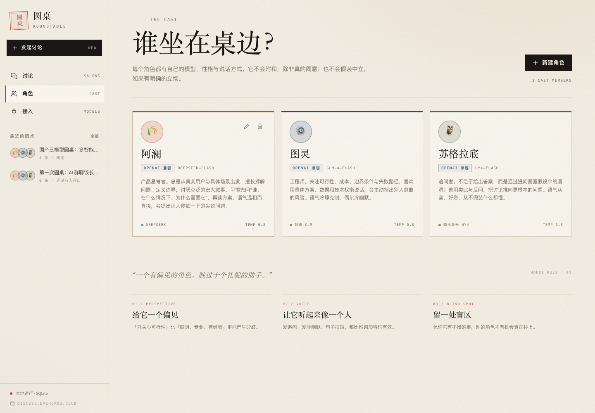
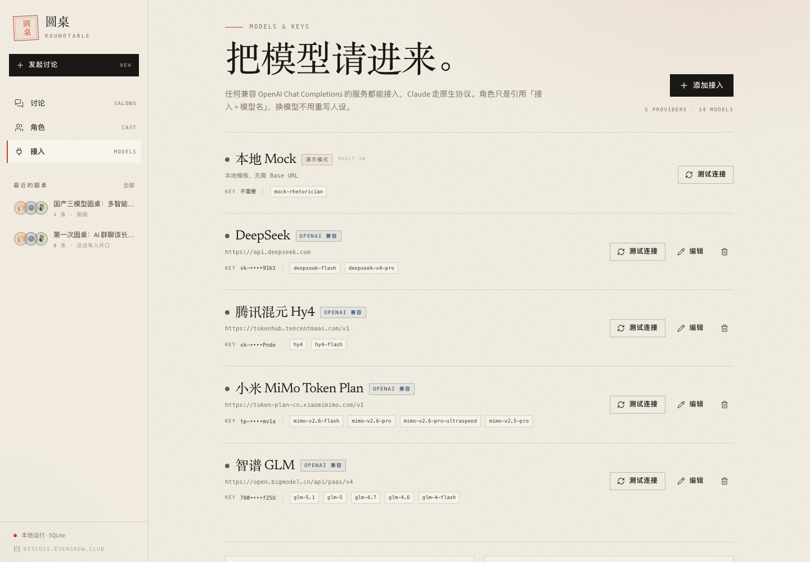
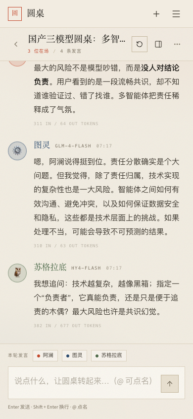
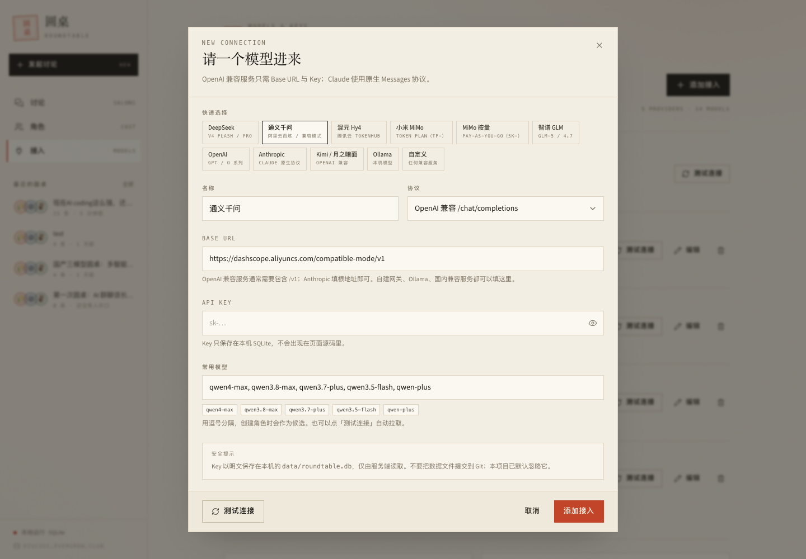
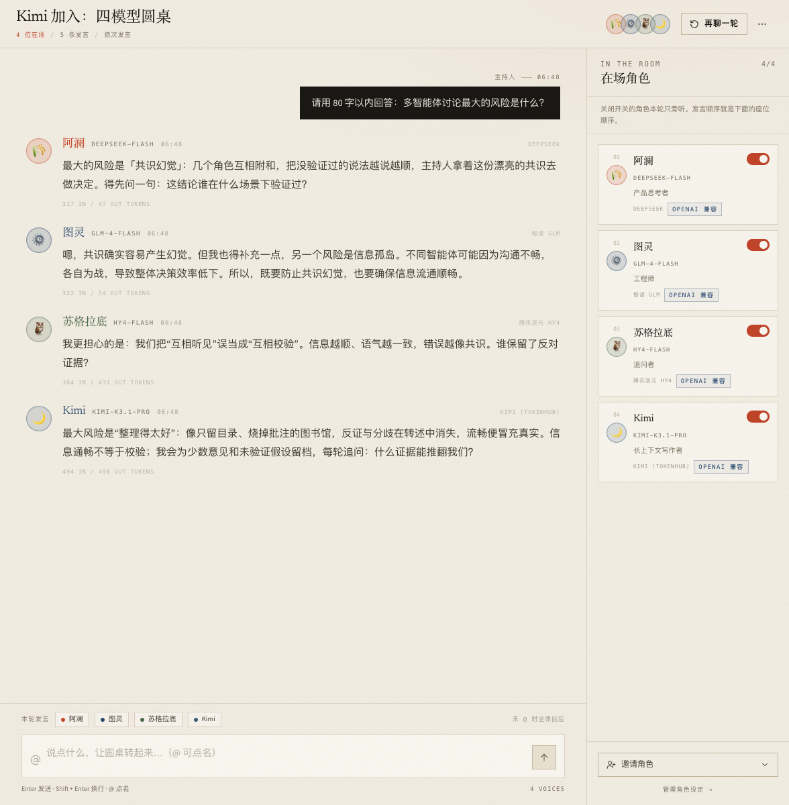

# 圆桌 · Roundtable

> 把一个问题放到桌子中央，让几位 AI 角色看见彼此、轮流发言。

一个可本地运行的「AI 多智能体沙龙」。你可以配置多家 LLM 接入，创建有独立人设的角色，把它们请进同一个房间；发言后角色依次回应，并且每一轮都能读到前面角色刚说过的话。也可以 `@` 某一位，单独点名。



## 功能

- **配置化模型接入**：优先内置 DeepSeek、通义千问、Kimi、腾讯混元 Hy4、小米 MiMo、智谱 GLM 六家国产模型预设；同时支持 OpenAI 兼容协议（OpenAI、Ollama、自建网关…）与 Anthropic 原生协议。支持测试连接、拉取模型列表、Key 掩码显示。
- **多智能体群聊**：每个角色独立的人设、模型与温度；流式逐字输出；后面的角色能看到前面角色刚说的话。
- **用户控制参与权**：创建房间时选角；房间内随时开关「发言 / 旁听」；`@` 点名只让指定角色回应；随时停止一轮。
- **继续讨论**：不发言，直接点「再聊一轮」，让角色就刚才的话题继续交锋。
- **本地优先**：单个 SQLite 文件持久化；无外部服务、无登录；Key 只由服务端读取。
- **Markdown 消息**：表格、列表、引用、代码块与一键复制；显示 token 用量。

## 界面

| 讨论列表 | 发起新讨论 |
| --- | --- |
|  |  |

| 角色 | 模型接入 |
| --- | --- |
|  |  |

<p align="center">
  
</p>



## 快速开始

要求：**Node.js ≥ 24**（使用内置 `node:sqlite`，不需要编译原生依赖）与 **pnpm 10**。

```bash
pnpm install
pnpm dev
```

打开 [http://localhost:3000](http://localhost:3000)。

首次启动会自动创建 `data/roundtable.db`，并种下：

- 一个内置的「本地 Mock」接入（不需要 Key，回复由本地模板生成）；
- 三位角色：**阿澜**（产品）、**图灵**（工程）、**苏格拉底**（追问）；
- 一个空房间「第一次圆桌：AI 群聊该长什么样？」。

> 演示模式用于零配置体验完整流程。接入真实模型后，角色的人设才会真正生效。
>
> 如果**首次初始化前**已经配置了环境变量，对应的 Provider 会自动入库；角色默认仍绑定 Mock，到「角色」页切换模型即可。

### 接入真实模型

1. 打开左侧「接入」页 →「添加接入」；
2. 选择预设（DeepSeek / 通义千问 / Kimi / 混元 Hy4 / 小米 MiMo / 智谱 GLM / OpenAI / Anthropic / Ollama）或「自定义」；
3. 填写 Base URL 与 API Key，点「测试连接」；
4. 到「角色」页编辑角色，选择新的接入与模型。

也可以在**首次初始化前**通过环境变量种入 Provider（已有数据库不会重复种入）：

```bash
cp .env.example .env
# DEEPSEEK_API_KEY=
# DASHSCOPE_API_KEY=     # 阿里云百炼（通义千问）
# DASHSCOPE_BASE_URL=    # 可选：业务空间专属地址
# TOKENHUB_API_KEY=      # 腾讯云 TokenHub，用于 hy4 / hy4-flash
# MIMO_API_KEY=          # 小米 MiMo：tp- 走 Token Plan，sk- 走按量付费
# ZHIPU_API_KEY=         # 智谱开放平台（GLM）
# MOONSHOT_API_KEY=      # Kimi / 月之暗面（K3.1 Pro）
# OPENAI_API_KEY=
# ANTHROPIC_API_KEY=
```

### 国产模型接入参数

| 模型 | 协议 / 网关 | Base URL | 推荐 model | Key 环境变量 |
| --- | --- | --- | --- | --- |
| DeepSeek | OpenAI 兼容 | `https://api.deepseek.com` | `deepseek-flash` / `deepseek-v4-pro` | `DEEPSEEK_API_KEY` |
| 通义千问 | 阿里云百炼兼容模式 | `https://dashscope.aliyuncs.com/compatible-mode/v1` | `qwen4-max` / `qwen3.8-max` / `qwen3.7-plus` / `qwen3.5-flash` | `DASHSCOPE_API_KEY` |
| 腾讯混元 Hy4 | 腾讯云 TokenHub | `https://tokenhub.tencentmaas.com/v1` | `hy4` / `hy4-flash` | `TOKENHUB_API_KEY` |
| 小米 MiMo（按量） | OpenAI 兼容 | `https://api.xiaomimimo.com/v1` | `mimo-v2.6-flash` / `mimo-v2.6-pro` | `MIMO_API_KEY`（`sk-`） |
| 小米 MiMo（Token Plan） | OpenAI 兼容 | 以 Token Plan 控制台专属地址为准 | `mimo-v2.6-flash` / `mimo-v2.6-pro` | `MIMO_API_KEY`（`tp-`）+ `MIMO_BASE_URL` |
| 智谱 GLM | OpenAI 兼容 | `https://open.bigmodel.cn/api/paas/v4` | `glm-5.1` / `glm-5` / `glm-4.7` | `ZHIPU_API_KEY` |
| Kimi / 月之暗面 | OpenAI 兼容 | `https://api.moonshot.cn/v1` | `kimi-k3.1-pro` / `kimi-k3` | `MOONSHOT_API_KEY` |

几点说明：

- DeepSeek 的旧模型名 `deepseek-chat` / `deepseek-reasoner` 已于 2026-07-24 停用，请使用 `deepseek-flash` / `deepseek-v4-pro`。
- 混元 Hy4 通过腾讯云 TokenHub 接入，Key 在 TokenHub 控制台创建；TokenHub 同一个 Key 也可按“自定义接入”调用它聚合的其他模型。
- Kimi 的旧模型名 `kimi-latest` / `kimi-k2` 已逐步停用，请使用 `kimi-k3.1-pro` / `kimi-k3`。如果已有腾讯云 TokenHub Key，也可以直接用「Kimi（TokenHub）」预设，Base URL 为 TokenHub 的兼容地址。

Kimi 加入后的四模型真实圆桌：


- 通义千问使用阿里云百炼的 OpenAI 兼容模式；`qwen4-max` 是 2026-11 的新旗舰。若你使用新版 MaaS/业务空间专属域名，把 `DASHSCOPE_BASE_URL` 设为控制台给出的地址即可。
- 小米 MiMo 有两种互不通用的凭据：按量付费 `sk-` 走 `api.xiaomimimo.com`；Token Plan `tp-` 必须使用控制台「Token Plan」页给出的**专属 Base URL**（中国通用地址为 `https://token-plan-cn.xiaomimimo.com/v1`，但以控制台为准），两者不能混用。
- GLM 的 Base URL 必须带 `/api/paas/v4`，不要只填 `https://open.bigmodel.cn`。若账户余额不足，可使用免费模型 `glm-4-flash` 先体验。
- 兼容性实测（2026-11）：DeepSeek `deepseek-flash`、腾讯混元 `hy4-flash`、智谱 `glm-4-flash` 已完成真实流式对话验证；Kimi `kimi-k3.1-pro` 通过 TokenHub 调用验证；GLM-5 系列需要账户余额。通义千问端点已确认可达，等待 DashScope Key 做真实调用。MiMo 的 Token Plan Key 必须配控制台专属 Base URL。

## 怎么用

1. **发起讨论**：填写主题，勾选入席角色。角色顺序就是发言顺序。
2. **发送一句话**：未 `@` 时，所有在场的角色会按座位顺序依次回应；每一个都能看到前面角色的发言。
3. **`@` 点名**：在输入框键入 `@`，从弹出列表选择角色，只有被点名的角色会回应。
4. **调整参与者**：右侧「在场角色」面板关闭某位角色的开关，它就只旁听、不发言；也可以邀请尚未入席的角色。
5. **再聊一轮**：不打断节奏，让角色继续上一轮的话题。
6. **停止**：流式过程随时停止，已经生成的部分会保留并标记为「已停止」。

## 架构

```text
src/
  app/
    rooms/                  讨论列表 + 群聊页（Server Components）
    agents/                 角色管理
    settings/               模型接入
    api/
      providers/            接入 CRUD / 测试连接 / 拉取模型
      agents/               角色 CRUD
      rooms/                房间 CRUD
      rooms/[id]/messages/  发消息 + SSE 流式发言
      rooms/[id]/round/     继续一轮（无用户消息）
      rooms/[id]/stop/      中止当前一轮
  components/               UI（纸墨沙龙风格）
  lib/
    db.ts / seed.ts         node:sqlite 初始化、迁移、种子数据
    repo/                   providers / agents / rooms / messages 仓储
    llm/                    OpenAI 兼容 / Anthropic / Mock 适配器
    prompt.ts               角色 system prompt 与多说话人上下文
    selection.ts            本轮发言者选择（全员 / @ 点名）
    round.ts                一轮讨论的编排：排队、流式、落库、中止
    sse-response.ts         SSE 响应、心跳与断连清理
```

### 一次发言发生了什么

```text
浏览器 POST /api/rooms/:id/messages
  └─ 校验 → 获取房间级锁 → 写入用户消息
     └─ 选出本轮发言者（启用角色 / @ 点名）
        └─ for 每个角色：
             读取完整共享记录
             ├─ 自己的历史消息 → assistant
             ├─ 主持人与其他角色 → 带说话人标签的 user
             流式调用模型 → SSE delta → 浏览器逐字渲染
             结束后写入消息、token 用量与状态
        └─ done → 释放房间锁
```

- 前后端同一个 Next.js 项目：页面用 Server Components 直读 SQLite，交互走 Route Handlers；不需要额外后端服务。
- 会话使用 **SSE**（`text/event-stream`）而不是 WebSocket：单向流式、断线可感知、实现简单。
- 房间级内存锁防止同一房间并发开两轮；`AbortController` 贯穿 fetch → 模型请求 → 落库，停止时保存部分内容。
- 数据库是单文件 SQLite（WAL）。`node:sqlite` 让项目不需要 `better-sqlite3` 之类的原生扩展。
- OpenAI 兼容适配器遇到 400 时会自动去掉 `temperature` 重试一次，并记住该 `provider + model`。Kimi K3.1 Pro 经 TokenHub 调用时就不接受这个字段。
- API Key 只在服务端使用；浏览器拿到的 Provider 只有 `hasKey` 与末四位掩码。

### 数据模型

| 表 | 说明 |
| --- | --- |
| `providers` | 接入配置：协议、Base URL、Key、常用模型 |
| `agents` | 角色：人设、表情/颜色、provider + model、temperature |
| `rooms` | 讨论房间 |
| `room_agents` | 席位：谁在场、是否启用、发言顺序 |
| `messages` | 共享消息记录：user / agent、流式状态、错误、用量 |

## API

| 方法 | 路径 | 说明 |
| --- | --- | --- |
| `GET/POST` | `/api/providers` | 列出 / 新建接入 |
| `PATCH/DELETE` | `/api/providers/:id` | 更新 / 删除接入（被角色引用时拒绝删除） |
| `POST` | `/api/providers/test` | 测试连接，可复用已保存 Key；返回可用模型 |
| `GET` | `/api/providers/:id/models` | 拉取 OpenAI 兼容服务的模型列表 |
| `GET/POST` | `/api/agents` | 列出 / 新建角色 |
| `PATCH/DELETE` | `/api/agents/:id` | 更新 / 删除角色 |
| `GET/POST` | `/api/rooms` | 列出 / 新建讨论 |
| `GET/PATCH/DELETE` | `/api/rooms/:id` | 房间详情 / 改标题、阵容 / 删除 |
| `POST` | `/api/rooms/:id/messages` | 发消息并流式获得角色回应（SSE） |
| `POST` | `/api/rooms/:id/round` | 不开新用户消息，继续一轮（SSE） |
| `POST` | `/api/rooms/:id/stop` | 中止当前一轮 |

SSE 事件：`user_message`、`round_start`、`agent_start`、`delta`、`agent_end`、`agent_error`、`notice`、`fatal`、`done`。

## 开发与验证

```bash
pnpm test        # 30 个单元测试：SSE 解析、Prompt、发言选择、适配器、数据层
pnpm typecheck
pnpm build
```

重置本地数据（会删除所有讨论、角色与 Key）：

```bash
rm -rf data
```

数据库位置可用 `ROUNDTABLE_DB_PATH` 指定；默认 `./data/roundtable.db`。

## 设计

「纸墨沙龙」：暖纸底色 + 纸张颗粒、墨色正文、朱砂强调、宋体标题、细发丝线。字体自带托管（Newsreader / Source Sans 3），中文回退到 Songti SC / PingFang SC。角色颜色只用于身份识别，不做渐变堆叠。整体刻意偏编辑/印刷感，而不是常见的高饱和 AI 紫。

## 边界与后续

当前是单用户本地 MVP，刻意没有做：账号与多租户、限流与配额、房间共享链接、向量记忆/RAG、工具调用、自主多轮（agent 决定下一位）、导出与分享。

已知取舍：

- API Key 明文存储在本机 SQLite，适合个人本地使用；部署到公网前应加用户体系、加密与访问控制。
- 同一房间的发言严格串行；并发请求返回 409。
- 长上下文按字符预算裁剪（默认约 28k 字符），暂无 token 级精确计算。
- 每个角色每轮发言一次，不做无限自动接龙。

如果你要把它做成真正的「AI 界 QQ」，下一步最值得加的是：用户账号与群成员、可分享的直播间、角色记忆与@提醒。
